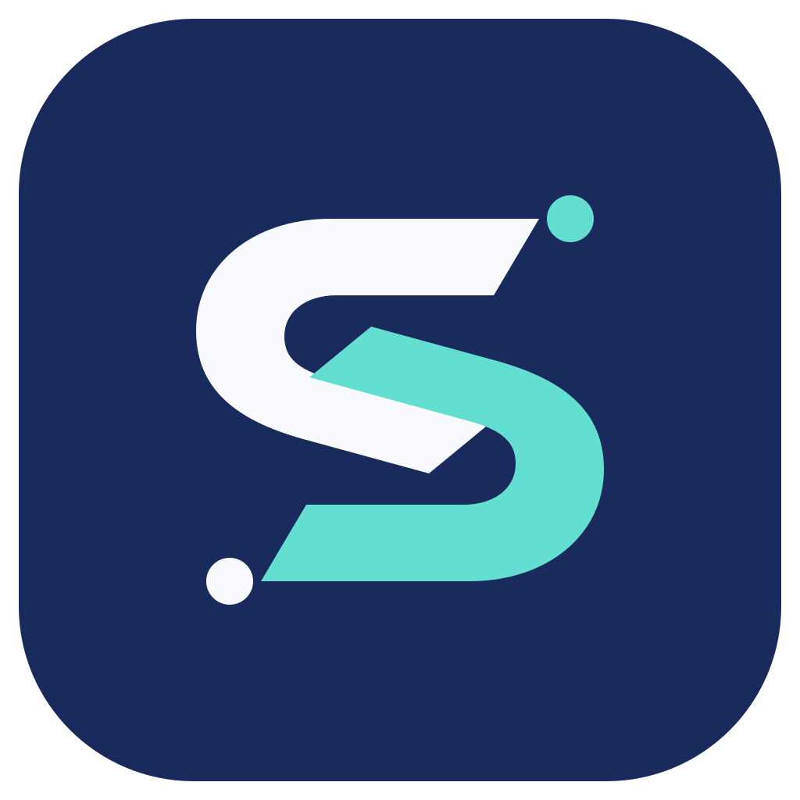
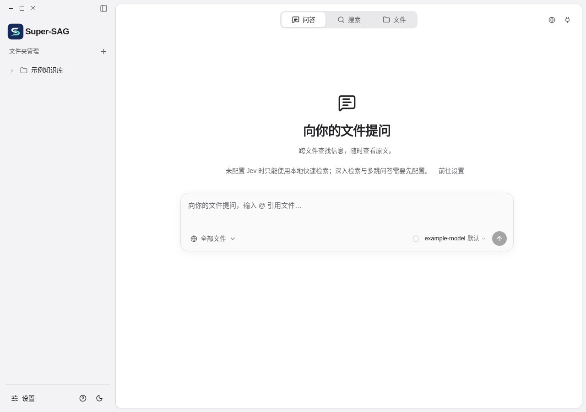

<p align="center"></p>
<h1 align="center">Super-SAG</h1>
<p align="center"><a href="README.md">English</a> · 简体中文</p>

Super-SAG 面向个人和 Agent 提供本地知识库，包含文件夹管理、索引、搜索、问答、文件操作、设置与 CLI。

**当前版本：`v0.1.0`。** [Windows 安装包已发布](https://github.com/CalmBuilder/Super-SAG/releases/tag/v0.1.0)；完整业务及保留数据升级仍需验收。macOS 个人版正在验证，尚未发布安装包。独立签名更新通道建立前，应用内自动更新暂不可用。



图片由浏览器测试替身生成，不能作为 Windows 原生验收证据。原文件保留在原目录；需要模型的检索和问答使用用户配置的服务。

## 在 Windows 上构建

准备 Git、Node.js、Rust stable 的 Windows MSVC 工具链、Microsoft C++ 构建工具及 WebView2；构建时需联网获取依赖和 NSIS。在 PowerShell 中执行：

```powershell
git -c core.autocrlf=false clone https://github.com/CalmBuilder/Super-SAG.git
Set-Location Super-SAG
git config --local core.autocrlf false
npm.cmd ci
npm.cmd run check
npm.cmd run package:windows
```

安装器预计位于 `src-tauri/target/release/bundle/nsis/`，以实际构建输出为准，并记录其 SHA-256。任一步失败应停止排查。安装前请阅读 [Windows 构建与实机验收清单](docs/web端设计/08-Windows构建与实机验收.md)。覆盖升级必须先在隔离环境中使用备份和测试数据演练，不要覆盖唯一一份业务数据。

## 项目顺序

1. 完成并验收 Windows 与 macOS 个人桌面版，包括全新安装、业务和保留数据升级。两者均不要求登录和选择租户。
2. 以验收通过的 Windows 安装版为基准，先完成 Linux Web 样式与交互，再逐项接通业务。
3. Web 对齐后增加用户、租户和授权。旧 Web 原型只复用权限设计和测试经验，旧代码与数据库不迁入。

当前浏览器夹具仅用于开发预览，使用虚构响应，并非 Web 服务。方案和验收记录见 [docs/web端设计](docs/web端设计/README.md)，中英文使用文档见 [docs-site](docs-site/README.md)。

## 第三方依赖

随应用分发的独立第三方依赖及其许可见 `src-tauri/licenses/`。
