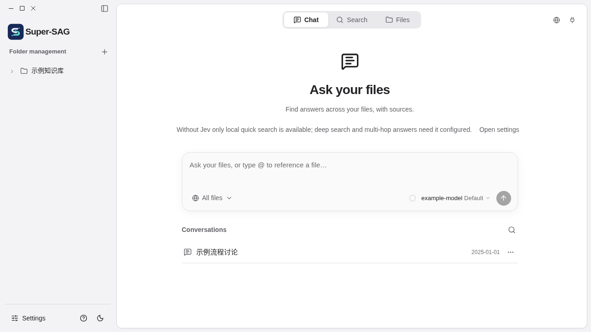

<p align="center"></p>
<h1 align="center">Super-SAG</h1>
<p align="center">English · <a href="README-CN.md">简体中文</a></p>

Super-SAG provides a local knowledge base for people and agents, with folder management, indexing, search, Q&A, file operations, settings and a CLI.

**Current version: `v0.1.0`.** A [Windows installer is published](https://github.com/CalmBuilder/Super-SAG/releases/tag/v0.1.0); complete business workflows and data-preserving upgrade still require acceptance. The macOS personal edition is under verification and no macOS installer has been published. Automatic updates remain disabled until an independent signing channel exists.



The image uses synthetic data in a browser test fixture; it is not evidence of native Windows acceptance. Original files remain in their folders; model-backed retrieval and Q&A use the services configured by the user.

## Build on Windows

Prepare Git, Node.js, Rust stable with the Windows MSVC target, Microsoft C++ build tools and WebView2. Network access is required to obtain dependencies and NSIS. From PowerShell:

```powershell
git -c core.autocrlf=false clone https://github.com/CalmBuilder/Super-SAG.git
Set-Location Super-SAG
git config --local core.autocrlf false
npm.cmd ci
npm.cmd run check
npm.cmd run package:windows
```

The installer is expected under `src-tauri/target/release/bundle/nsis/`; use the actual output and record its SHA-256. Stop if a command fails. Follow the [Windows build and acceptance checklist](docs/web端设计/08-Windows构建与实机验收.md) before installing. Upgrade testing must use isolated data and a backup of the original app; do not overwrite the only copy of production data.

## Project order

1. Finish and accept the Windows and macOS personal desktop apps, including clean installation, business workflows and data-preserving upgrades. Neither requires login or tenant selection.
2. Use that accepted Windows build as the baseline for Linux-hosted Web UI and behavior, then connect equivalent business functions.
3. Add users, tenants and authorization after Web parity. Only permission design and testing experience are reused from the old Web prototype; its code and database are not migrated.

The current browser fixture is a development preview with synthetic responses, not a Web service. Detailed scope and acceptance records are in [docs/web端设计](docs/web端设计/README.md). Bilingual user documentation is in [docs-site](docs-site/README.md).

## Third-party dependencies

Licenses for the independent third-party dependencies shipped with the application are in `src-tauri/licenses/`.
