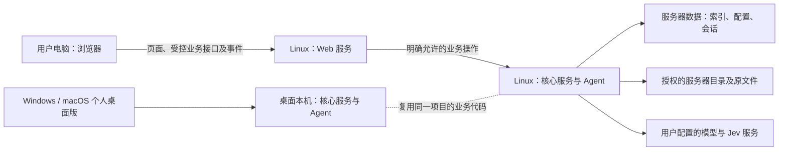

# 11 Linux + Web 详细实施方案

状态：方案与代码盘点，尚未实施正式 Web。记录日期：2026-11-11。本文是执行清单，不代表任何新功能或验收已完成。

## 目标与已确认边界

- 以 Super-SAG Windows 个人版为产品及界面基准；先完成 Web 全部界面和交互对照，再逐项接入真实业务。保留知识库、原文件、索引、搜索、问答、设置、CLI/Agent 等桌面能力；操作系统差异逐项登记并确认。
- 本项目是在现有代码基础上增加 B/S 运行方式：Windows/macOS 个人版继续作为本地桌面应用；Web 版由 Linux 承载服务、业务核心及 Agent，用户电脑通过浏览器访问，无需安装桌面客户端或本地 Agent。两种运行方式复用代码，但各自使用本地或服务器数据，不能假定自动同步。
- 主要数据来源是管理员明确授权的 Linux 服务器目录，而非浏览器所在电脑；浏览器上传可以作为补充。保留真实目录层级和原文件，移除知识库不删除原文件。
- 旧 Web 原型的代码、服务及数据库不迁入，只借鉴设计与测试经验。复用现有桌面组件、样式和 Rust 业务内核；不把现有开发预览、其 Web 专用壳层或测试替身直接作为正式实现。桌面共享代码中的预览分支先审计和隔离，保留桌面行为后再接入新的 Web 实现。
- 启动入口为 `app.sh`，按既定要求监听 `0.0.0.0:8167`。用户确认首阶段仅在**隔离测试内网**使用；此阶段不是可供多人或公网使用的正式服务。多用户、多租户和授权隔离排在 Web 业务对齐之后。
- 用户确认 Web 首版正式支持桌面 Chrome、Edge、Safari。此前关于客户端 CLI/Agent 的问法不符合 B/S 初衷；用户已澄清 **Web 版 Agent 运行在服务器端**。服务端 CLI/Agent 的具体接入方式按桌面能力逐项设计，桌面个人版的本机 CLI/Agent 保持原有能力。
- 用户反馈 Windows 全部业务及保留数据升级已通过实机测试，并提供了验收安装包摘要和源码提交；macOS 正式分发暂缓，macOS 未完成的验收仍需独立记录，不阻塞 Web 准备。

## 当前事实与基准

- 本次盘点的代码提交为 `87e133b`；现有 `src/App.svelte`、`src/components/` 及样式是桌面功能的主要来源，`src/lib/api.ts` 当前直接调用 Tauri；多个组件还直接订阅 Tauri 事件或调用原生窗口能力，不能只更换一个 API 地址就完成 Web 化。初步范围见[桌面能力盘点](12-桌面能力与Web适配盘点.md)。
- `core/` 包含目录、索引、检索、问答和文件等核心逻辑；`client/` 和 `protocol/` 提供本机服务通信。现有服务监听回环地址，并用本机连接记录中的令牌建立连接；它不是浏览器接口。
- 尚无正式 `app.sh` 或 Web 服务。现有预览仅渲染开发测试替身，且已知窄屏菜单遮挡和浏览器同源存储问题；不能作为正式 Web 产品或业务通过的证据。
- 本次盘点环境为 Ubuntu 24.04.3 LTS x86_64，仅作为首个开发测试环境，不代表已经支持全部 Linux 发行版或架构。
- [Windows 用户验收基准](验收证据/26-Windows用户验收基准.md)：用户确认全部业务及保留数据升级通过，源码为 `9459f4b90617a2042d20848eea6560e0d6812ebe`，验收包 SHA-256 为 `F6B96076EA23BFC9C537C3D3B2B245A5D296EABDFC243FF588ED816BB2A7A644`。与工作树起点 `87e133b` 比较，桌面核心、UI 与构建目录无差异，Safari 扩展引导有差异。Web 对照时另记录 Windows 版本、DPI、窗口尺寸、语言、主题、样例数据及截图；不同包或源码不能混称同一基准。

## 技术结构

1. **前端：**抽取明确的桌面/Web 平台能力接口，分别适配业务请求、索引/会话事件、窗口/弹窗、剪贴板、下载及快捷键；桌面仍使用 Tauri。新增浏览器入口引用同源桌面组件、样式、翻译和交互状态，访问端只需要浏览器。视觉阶段的替身只运行在隔离测试环境，不能打入或冒充正式业务。
2. **Web 服务：**新增独立 Linux 服务，同一来源提供构建后的前端和明确命名的业务接口；逐项校验输入、资源和错误。只在服务内部复用现有 `sag-client`/`sag-core` 的适用能力，不向浏览器暴露 Tauri 命令、本机服务令牌、任意 `Operation` 代理或任意命令执行。优先复用一个受管理的核心服务及独立 Web 数据目录，避免多个进程同时持有同一数据存储；最终连接和生命周期需通过真实测试确定。
3. **事件与流式：**为索引状态、查询进度、回答、工具确认和取消设计明确的事件契约，初步采用 HTTP 请求加 SSE。建立任务与客户端归属、先订阅后发起、取消幂等、断线重连、有限缓冲及缺口恢复机制；重连无法恢复的内容必须明确提示并读取可信最终状态。当前核心服务按连接归属事件，广播拥塞时可能丢失进度并提示刷新；不得假定它已经提供完整重放或跨用户隔离。
4. **数据与运行：**文件系统权限与服务端配置的授权根目录共同生效；应用数据目录与知识库原文件分开。索引、会话和设置在重启后保留，日志不记录密钥或文档全文。构建与运行、备份恢复和升级策略须以实际实现及测试为准。

## 目录与测试内网边界

- 管理员先在服务端配置可访问根目录，页面只能在授权范围内浏览和选择子目录；未经配置、没有系统权限或目录失效时明确拒绝并提示。页面中选到的是 Linux 服务器目录，而非客户端 Windows/macOS 目录。
- 列目录、读文件、创建、编辑、索引、搜索结果、引用来源、图片、后台任务和工具调用均需遵循同一范围；服务端校验，不能只靠前端隐藏。必须覆盖路径穿越、符号链接、硬链接、文件替换竞态、挂载变化和权限撤销；实现应结合目录句柄/受限解析及操作系统权限，不能只依赖字符串前缀。对无法安全判定的情况默认拒绝，具体支持能力以测试结果为准。
- 服务使用权限受限的专用系统账户及隔离测试文件；不以 root 权限运行应用，不把系统根目录作为默认授权范围。禁止因取消、移除、清空索引或失败而删除原文件；仅用户明确执行的新建和编辑才写原文件，保存需有冲突检测和失败恢复。
- `0.0.0.0` 表示所有网卡监听，本身不是访问控制。首阶段使用防火墙/测试网络限制可达客户端，同时验证 Host、Origin、跨站请求、资源路径和浏览器内容渲染等边界。可访问该测试服务的客户端在单用户阶段共享同一数据与权限，不能当成用户隔离或正式内网多人服务。
- 局域网 HTTP 地址可能不满足浏览器安全上下文要求，剪贴板等能力必须按实际浏览器验证；需要时在保留服务监听端口的前提下配置受控 HTTPS 代理或提供明确的可操作替代，不得静默显示复制成功。
- 若之后需要企业内网多人或互联网访问，先另行落实身份认证、传输保护、授权及部署方案；不要直接对外开放当前测试实例。未来多租户的权限检查需贯穿文件、索引、检索、问答、任务、事件和缓存，但本阶段不抢先实现租户功能。

## 分阶段工作与出口

每个 Web 视觉和业务小阶段均执行正常、极值、边界、失败及真实浏览器回归；涉及桌面共享代码时，验证 Windows 与 macOS 原生行为并区分云环境和用户实机。正式支持的 Chrome、Edge、Safari 均须在受影响的功能项上实际回归；仅有 Chromium 或 WebKit 测试不能冒充三个品牌浏览器通过。没有真实业务的视觉测试明确标注替身，未完成项不能标记通过。

| 阶段 | 实施内容 | 完成条件和证据 |
| --- | --- | --- |
| P0 基准与清单 | 冻结候选源码和测试资料，逐页盘点 Windows 操作、Tauri API/事件、文件格式和平台差异；列出各功能对应的 Windows 证据及状态。 | 可追溯到安装包、提交、截图、测试文件摘要和具体操作；未验项目显式保留。基准未冻结前只做准备和标注为临时的对照。 |
| V1 框架与公共交互 | 建立新浏览器入口与平台适配，复用桌面公共框架，覆盖品牌、侧栏、文件夹树、顶部三工作区、主题、中英文和导航。 | 相同 Windows 对照条件下检查布局、焦点、键盘、滚动、长名称、空/大量项目及失败；逐项留存真实 Chrome、Edge、Safari 截图与差异。 |
| V2 问答和搜索界面 | 覆盖空状态、输入、模型及范围选择、会话、消息、流式、取消、工具确认、引用、快速/深入搜索、结果和原文定位。 | 使用隔离且确定性的测试替身触发正常、长内容、空结果、断流、取消和错误；证明交互状态，不声称真实检索/问答通过。 |
| V3 文件、文件夹与设置界面 | 覆盖目录多选、弹窗、层级、过滤、文件列表、预览、编辑、新建、全部设置分类、保存/取消和各种异常状态。 | 检查多层和空目录、超长名称、隐藏项、选项边界、失败及关闭恢复；测试替身不得修改真实目录。 |
| V4 视觉总回归 | 核对所有桌面状态及差异；检查深浅色、中英文和各窗口尺寸，包括 320、375、768 像素边界。 | V1–V3 完整通过已确认的 Windows 对照，已知窄屏菜单遮挡与同源存储污染不得进入新实现；系统能力差异已登记、需要产品决定的项目已确认。之后才进入真实业务接入。 |
| B0 服务骨架 | 创建 Web 服务与 `app.sh`，同源交付前端，建立受控目录配置、请求与事件基础、安全和生命周期。 | 隔离内网启动、停止、重启、状态、日志、端口冲突、异常退出、无授权目录和浏览器访问回归通过；仅能声称服务骨架通过。 |
| B1 目录与文件读取 | 接入授权目录浏览、添加/移除、层级及原文查看。 | 用真实 Linux 文件及不同权限验证多选、中文/长路径、越界、链接、删除或失效；移除后原件摘要不变，并在真实浏览器验证。 |
| B2 索引与更新 | 复用格式识别/解析、忽略规则、索引状态及增量更新。 | 用与 Windows 相同的真实样例核对支持格式、索引状态和搜索准备；验证空目录、大量文件、修改/移动/删除、权限不足、失败重试和重启恢复。 |
| B3 文件操作 | 接入原文、预览、编辑、新建、草稿、保存冲突和笔记。 | 实际比对原文件及摘要，验证并发修改、只读、目标已存在、取消、磁盘不足和失败恢复；不覆盖无关文件。 |
| B4 搜索 | 接入快速/深入搜索、范围、Jev、排序、结果分页和原文定位。 | 相同文件、索引、配置与查询下对照 Windows 的真实结果、路径和定位；验证空结果、长查询、服务不可用、取消和权限边界。 |
| B5 问答 | 接入模型配置、会话、流式回答、工具确认/调用、来源引用与停止。 | 使用可控服务测试边界，同时使用真实配置完成问答并核验引用指向实际原文；覆盖断线、重连、超时、取消和错误。模拟模型不能代替真实模型验收。 |
| B6 其他能力与差异 | 设置、快捷键、网页剪藏以及 Linux 服务端的 CLI/Agent 等按清单逐项接入或提出平台适配；确认具体交互。 | 在 Linux 服务端实测 CLI/Agent、工具调用和错误，在浏览器实测对应配置及反馈；不可原样实现的功能明确区别并与用户确认，不静默删除或宣称完全一致。 |
| B7 部署和综合回归 | 完成 Linux 运行、数据持久化、日志、备份恢复及可复现交付；补齐文档。 | 在干净目标 Linux 环境按 `app.sh` 完成安装运行、异常恢复与完整浏览器业务回归；确认隔离范围、文件与索引结果及原生桌面无退化。 |
| T 多用户与多租户 | 在前述业务完成后，单独实施身份、成员、租户、知识库授权及隔离。 | 从产品入口真实创建第二租户并运行实际业务，验证多用户、多角色、跨租户拒绝、撤权、会话和文件/索引/配置隔离。详见[权限设计](03-多租户与权限设计.md)。 |

## 平台差异处理

| 桌面能力 | Web 阶段拟议方向 | 验收与决策 |
| --- | --- | --- |
| 原生窗口、托盘和后台进程 | 浏览器页面不伪装为 Windows 原生窗口；关闭页面和停止服务分别处理。 | 逐项展示差异，确认关闭页面后任务和服务行为。 |
| 本机文件选择器和资源管理器 | 主要选择受授权的 Linux 目录；本地上传、浏览器打开/下载作为补充。 | 清楚标识路径属于服务器还是客户端；不能声称浏览器直接访问客户端任意目录。 |
| 全局快捷键、通知、剪贴板 | 优先页面内快捷键和浏览器授权能力。 | 对系统全局快捷键、权限拒绝、浏览器冲突提出可行替代并确认。 |
| CLI/Agent、MCP 和工具 | Web 版在 Linux 服务器运行 Agent 和服务端 CLI，通过浏览器配置和使用；现有桌面个人版继续在本机运行。 | 不要求 Web 用户电脑安装 Agent，不将服务器 CLI/工具直接作为任意远程命令；服务端接入与安全边界逐项验收。 |
| 网页剪藏、下载与自动更新 | 区分客户端浏览器、Linux 服务和桌面安装包；按能力单独设计。 | 不假设桌面安装包或剪藏保存位置在浏览器中原样可用。 |

## 验收、记录与文档

- 按阶段保存源码提交、操作系统/浏览器、启动方式、测试范围、测试文件 SHA-256、语言主题尺寸、结果截图、实际结果、失败与未完成项。稳定视觉可使用虚构资料和隔离浏览器 profile；真实业务必须使用真实服务和文件，结果可复现。
- 正常、极值、边界和失败用例应为每个切片事先指定具体输入，不以截图、HTTP 成功或构建通过代替业务核验。索引要核对内容与更新；搜索要核对实际来源和定位；问答要核对事实、引用与原文，不要求不确定的模型输出逐字相同。
- 前端仅使用当前阶段所需测试替身；涉及真实业务的测试必须验证真实文件/索引和浏览器操作。对不同配置或平台有差异的结果单独记录，不能将云端运行表述为物理设备通过。
- 每次列明实际浏览器品牌、版本、系统及运行环境。Chrome/Edge 使用真实对应浏览器；Safari 使用 macOS 自带 Safari 和其 WebDriver，先验证云端 macOS 能否启动并完成交互。Playwright WebKit 仅作为补充，不能替代 Safari；若云环境不具备真实 Safari 交互能力，该项保持未通过并寻找可用原生环境。参考 [Apple Safari WebDriver](https://developer.apple.com/documentation/webkit/testing-with-webdriver-in-safari) 和 [Playwright 浏览器说明](https://playwright.dev/docs/browsers)。
- 实施记录及证据放在 `docs/web端设计/`；对实际功能、安装、支持范围和界面有变化时，按 `AGENTS.md` 同步 `docs-site/` 中英文文档、相关截图并构建检查。未发布的安装包不提供正式下载链接。

## 下一步

先做 P0：形成 Windows 界面/操作与桌面命令及事件的逐项映射，核验可取得的 Windows 版本和截图；同时设计新的平台适配边界。P0 不接通目录或其他真实业务。之后按 V1 开始正式 Web 界面实现，视觉阶段全部通过后才进入 B0–B7。
